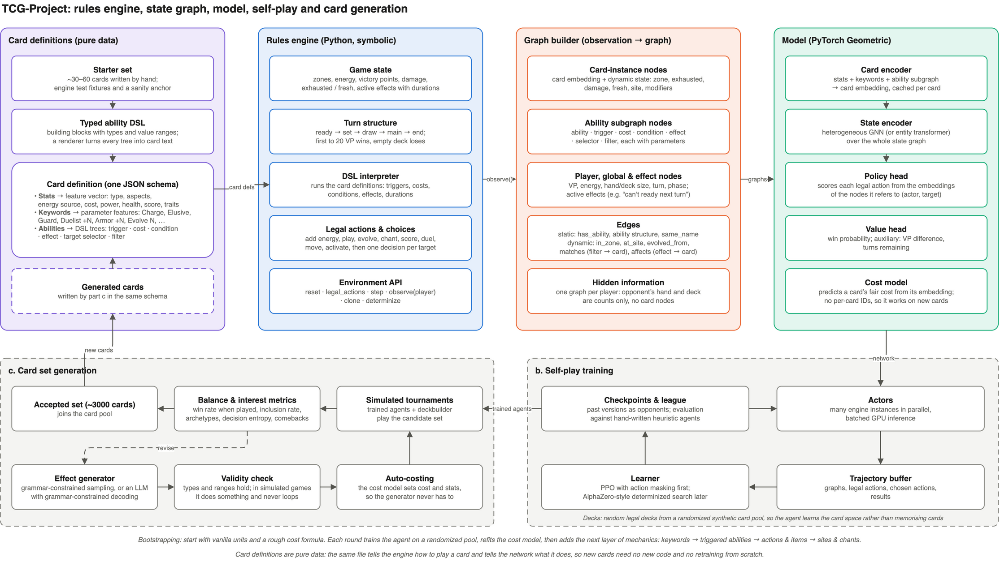
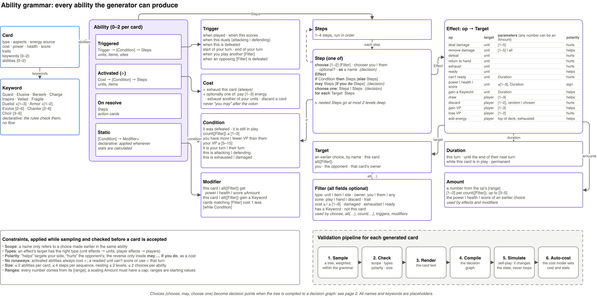
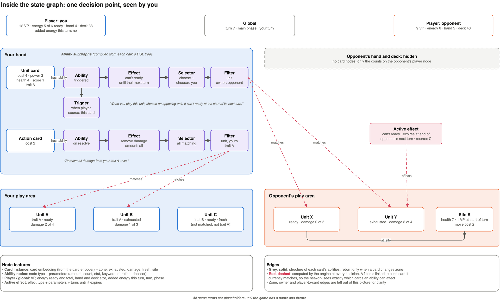

# Technical plan, part a: rules engine and graph representation

The project has three parts:

- **a.** Define a trading card game's rules and represent its state as a graph a GNN can
  learn from.
- **b.** Train an agent to play it through self-play.
- **c.** Generate a balanced, interesting set of ~3000 cards.

The card pool is **entirely synthetic**. No cards from any existing game are used. The
rules follow the broad structure of **Hearthstone** (rules v2, section 2): mana that grows
each turn, units that attack each other or the enemy hero, and a hero whose health is the win
condition. More people know it than any other card game, which matters for the players and for
the blog series that documents the project. The terms are our own placeholders. The aim is to
show that a whole card set can be generated from scratch once the rules are defined. This also
keeps the project free of card licensing issues.

> **Status (2026-10-21):** the engine runs rules v2. Rules v1 followed Disney Lorcana (ink,
> questing for lore, challenging exhausted characters); section 2b records what changed and
> what is left (protocol v2 for the Unity client, retraining).



The diagram source is [architecture.drawio](architecture.drawio). Page 1 is the system
overview above; page 2 shows the state graph in detail (section 5); page 3 is the ability
grammar: every ability the generator can produce (section 3).

## Placeholder glossary

All names are placeholders until the game has a name and theme. They live in one constants
module (`src/game/terms.py`), so a rename is a single change.

| Placeholder | Meaning |
|---|---|
| **Hero** | Each player's character, with 30 health. A hero at 0 health loses. (The theme may call it something like a Grand Mushroom.) |
| **Mana** | Paid to play cards. Each turn you gain an empty mana crystal (up to 10), then all of them refill |
| **Unit** | A card that stays in play: cost, power, health, traits (jobs) |
| **Action** | A one-shot card: its ability resolves, then it goes to the discard pile |
| **Attack** | A unit fights an enemy unit or the enemy hero, once per turn. Both sides deal their power as damage (heroes deal none back) |
| **Fresh** | Played this turn: can't attack or use ⟳ yet |
| **⟳ ability** | A unit's activated ability, used *instead of* attacking that turn |
| **Defeated** | Damage ≥ health: the unit goes to the discard pile |
| **Aspects** (6) | Habitats. Planned: Hearthstone-style classes (a deck is one aspect's cards plus neutral cards; the hero takes the deck's aspect). For now only colours: decks draw from the whole set |
| **Traits** | Unit tags that abilities can refer to: jobs (docs/theme.md) |
| **Keywords** | Guard, Charge, Duelist +N, Armor +N, Elusive |

## 1. Design principles

1. **A symbolic engine runs the rules; the GNN reads them.** The engine decides what is
   legal and what happens. The graph exposes the rules' *structure* to the network: what each
   ability does, which cards it can target, which effects are active. Generated cards need
   exact, trusted behaviour that a learned model can't guarantee.
2. **One card schema, two consumers.** Each card is pure data: stats, keywords and ability
   trees in a typed DSL. The engine *interprets* the DSL to play the card; the graph builder
   *compiles* the same tree into a subgraph for the network. A new card needs no new code.
3. **No per-card identity.** The network never sees a card ID or a learned per-card
   embedding, only what the card *is*. This lets it handle cards it has never seen, which
   part c depends on.
4. **Train on a randomized pool.** The agent always trains on a wide, randomized pool of
   synthetic cards and decks, so it learns the card space rather than particular cards.
5. **The generator proposes and the cost model prices.** The generator's job is
   *interesting* effects. A cost model learned from the agent's games sets cost and stats,
   which is where most of the balancing happens.

## 2. Rules scope (v2)

- **Players and decks.** Two players, 30-card decks (up to 2 copies of a card). Planned: one
  aspect's cards plus neutral cards, the hero taking the deck's aspect. For now aspects are only
  colours and decks draw from the whole set (`ONE_ASPECT` in `src/game/decks.py`).
  Each player has a hero with 30 health. A hero at 0 health loses; if both reach 0 at once,
  it's a draw.
- **Start.** The first player draws 3 cards, the second 5. Each player may replace any of
  their opening cards once (mulligan). The second player also gets the **Spare Spore**: once per
  game, gain 1 mana for that turn. This is Hearthstone's answer to the first player's tempo.
  With Hearthstone's 4 cards, the first player won 58–59% of mirror games; with 5, 49% for the
  league model and 54% for the heuristic agent (`scripts/experiments.py first`, 2026-10-22).
  Re-measure once card costs are learned.
- **Turn.** Start of turn: gain an empty mana crystal (up to 10), refill all crystals, units
  can attack again, "start of turn" effects trigger, draw a card. Then the main phase, then
  "end of turn" effects.
- **Main phase actions:**
  - play a card by paying its cost in mana
  - attack with a unit
  - use a unit's ⟳ ability instead of attacking with it
  - end the turn
- **Attacks.**
  - A unit can attack once per turn, but not on the turn it is played (Charge allows it).
  - It attacks an enemy unit or the enemy hero.
  - If the enemy has a Guard unit, an attack must target a Guard unit.
  - Both deal their power as damage to each other; a hero deals none back.
  - Damage on units stays between turns.
- **Limits.**
  - At most 7 units in play each.
  - At most 10 cards in hand: a card drawn into a full hand is discarded.
  - Drawing from an empty deck deals 1 damage to your hero, then 2, then 3, and so on.
- **Card types.** Unit and Action now; Item later.
- **Keywords** (the keyword list is data, so adding one is an engine change plus a feature
  column):

  | Keyword | Effect |
  |---|---|
  | Guard | Enemy attacks must target a Guard unit while there is one |
  | Charge | Can attack the turn it's played |
  | Duelist +N | +N power while attacking |
  | Armor +N | Takes N less damage from attacks |
  | Elusive | Can't be attacked or chosen by enemy abilities until it attacks or uses ⟳ |

**Aspects and jobs.** Aspects are classes (deckbuilding and, later, a strategic identity);
jobs are tribes that cross aspects (the synergies abilities refer to). Vanilla and keyword-only
units are neutral. Aspect identity isn't designed by hand: once a big generated pool exists,
clustering the cards by what they do (unsupervised) should suggest six groups to name after
the habitats. Until then ability cards get a random aspect and the deck rule is off, so aspects
are only colours.

**From v1, dropped:** ink and energy sources, scoring and VP, "only exhausted units can be
challenged", sites, chants and Evolve, and the keywords Berserk, Inspire, Veiled, Fragile,
Chanter and Choir. Some may come back as part 3's twist (section 2b).

**Layered rollout.** Each layer adds DSL building blocks and engine support, and is
followed by a bootstrapping round (section 8):

1. Vanilla units (stats only).
2. Keywords.
3. Simple triggered and activated abilities.
4. Actions and items.
5. The twist: a mechanic of our own (section 2b).

## 2b. Moving from v1 to v2

**What stays.** Most of the work so far doesn't depend on the resource or win rules:
- the ability DSL, decision graphs and the pending-ability stack
- the quality tests, traces, card lab and explorer, and names
- PPO and the GNN architecture

**What changed, in order** (steps 1–3 done 2026-10-21; the agent is retraining):

1. **Engine.**
   - mana in place of the energy zone
   - heroes and their health as the win condition
   - attacks on units or the hero, with Guard, once per turn
   - board and hand limits, empty-deck damage, the Spare Spore

   Actions: `ATTACK` (target: a unit or the hero) replaces `DUEL` and `SCORE`; `ADD_ENERGY` goes. Tests in
   `tests/test_engine.py`. Card schema: no `score`, no `energy_source`. Vanilla and keyword
   generators: cost budget from power + health only. Configurable hero health, so training
   can use shorter games.
2. **Ability grammar.** Heroes become targets, so player effects map onto unit effects:

   | v1 | v2 |
   |---|---|
   | gain VP | heal your hero (`remove_damage` on your hero) |
   | lose VP (opponent) | damage the enemy hero (`deal_damage` on the enemy hero) |
   | lose VP (you, as a cost) | damage your own hero |
   | add energy | gain an empty mana crystal |
   | can't ready | freeze: the unit can't attack on its next turn |
   | exhaust (enemy unit) | dropped: enemy units are refreshed on their turn anyway |
   | ready | the unit can attack again this turn |
   | "whenever this unit scores" | "whenever this unit attacks the enemy hero" |
   | "if you have fewer VP" | "if your hero has less health than theirs" |

   Then re-check every quality and card-level test, the costing table, the names (VP-themed
   subtitles) and the fuzz test, and regenerate the card sets.
3. **Graph and model.**
   - a node for each hero (health, mana, Spare Spore)
   - drop the score and energy-source features
   - retrain from scratch and re-benchmark
4. **Server and client.**
   - Protocol v2 in docs/client-protocol.md: heroes, mana, `attack` targets.
   - Client milestone 4: hero portraits with health, mana crystals, the enemy hero as an attack target; the energy zone and VP bars go.
5. **Docs.** This plan's sections 3–8, the README rules, client-design.md.

**The blog series** follows the same arc:
1. **Part 1:** the setup and card generation (grammar, quality tests, the card lab and explorer).
2. **Part 2:** self-play and balancing (the learned cost model).
3. **Part 3:** a twist that makes the game its own. Adding a mechanic means extending the
   grammar and engine, then regenerating and rebalancing the whole set automatically, so it
   also shows off the pipeline.

## 3. Card schema and ability DSL

```jsonc
{
  "id": "gen-000123",           // for bookkeeping only, never shown to the network
  "name": "…",                  // used for Evolve and "named X" checks, via same_name edges
  "subtitle": "…",              // tells apart versions of the same character
  "type": "unit",               // unit | action (item later)
  "aspects": ["aspect_1"],
  "cost": 4, "power": 3, "health": 4,
  "traits": ["trait_a"],
  "keywords": {"charge": true, "duelist": 2},
  "abilities": [ /* DSL trees, below; the generator makes one per card */ ]
}
```

**Abilities are written as trees and run as decision graphs.** Each ability exists in two
forms:

1. **Authoring form: a nested tree, stored in the card JSON.** This is what gets written by
   hand, generated, validated and rendered as card text. Trees are easy for all four.
2. **Decision graph, compiled once per card from the tree.** The engine executes it and the
   GNN reads it. Each step becomes a node. Control edges say what happens next. Data edges
   connect a choice to every later step that refers to it ("it", "that unit", "if you do").

Static abilities and keywords aren't sequences of steps. They are rules applied whenever
stats or legality are calculated, so they stay declarative and are never compiled into a
flow.



**Grammar (authoring form).** It is small, typed and closed. Page 3 of the diagram lists
every alternative and value range: it is the full space of abilities the generator can
produce.

```
Ability    := triggered(Trigger, [Condition], Steps)
            | activated(Cost, [Condition], Steps)            // "⟳ …": in the engine, not generated in v2
            | on_resolve(Steps)                              // action cards
            | static([Condition], Modifier+)                 // declarative, not compiled to a flow
Steps      := Step+                                          // 1–4 steps, run in order
Step       := choose(count, chooser, Filter, optional?) as Name    // decision point
            | Effect
            | if(Condition) then Steps [else Steps]
            | may(Steps) [if_you_do Steps]                   // yes / no decision point
            | choose_one(Steps, Steps)                       // decision point
            | for_each(Target) Steps
Effect     := op(Amount?, Target, [Duration])
Target     := Name | this | all(Filter) | you | opponent | owner_of(Name)
Trigger    := event + source (this | Filter)
Cost       := exhaust_this [+ pay(n) | exhaust_another | discard]      // ⟳ (this unit's attack) is always part of it
Condition  := defeated(Name) | in_play(Name) | count(Filter) ≥ n | behind_on_health | your_turn
            | this_is(attacking | defending | exhausted | damaged)
Modifier   := Subject gets stat ±Amount [while Condition]
            | Subject gains Keyword [while Condition]
            | cost(−1) for Filter
Subject    := this | all(Filter)
Amount     := n | k per count(Filter), up to cap | stat_of(Name)
Filter     := {type?, owner?, zone?, trait?, cost_cmp?, damaged?, exhausted?, keyword?, not_this?}
Duration   := this_turn | until_your_next_turn | until_their_next_turn | while_this_in_play | permanent
```

A `Name` can only refer to a choice made earlier in the same ability. That keeps every tree
valid and every reference renderable as text.

**Scaling amounts.** Wherever an effect or modifier takes a number, it can take an `Amount`
instead. That covers "deal 1 damage for each Elf in play" and "deal damage equal to its
power". A static ability can scale too: "While this unit is attacking, it gets +1 power for
each Elf in play (up to +4)" is `static(this_is(attacking), this gets power +(1 per
count(Elf in play), up to 4))`. Statics are recalculated live, so the count is taken when the
bonus is needed. A triggered version ("when this unit attacks, it gets +1 power this turn for
each Elf") takes a snapshot instead. In the state graph, a scaling amount is its own small
node with `matches` edges to the cards it is counting.

**Generation constraints.** These are applied while sampling, then checked again before a
card is accepted:

- **Scope.** References only point to earlier choices in the same ability.
- **Types.** An effect's target has the right type: unit effects target units, player
  effects target players.
- **Polarity.** Every effect either helps or hurts its target. Helpful effects target your
  side, harmful ones the opponent's. The reverse is allowed only inside `may … if_you_do`,
  as a cost ("You may deal 2 damage to one of your units. If you do, draw 2 cards.").
- **No runaway abilities.** In v2 abilities are static or triggered; units only attack. (The
  engine still runs activated abilities that cost ⟳, this unit's attack for the turn, so a
  later mechanic can bring them back.) There is no `ready` effect, so no unit attacks twice.
  Attack loops end by themselves, because units take damage.
- **Abilities must be able to matter.** These checks look at the whole card, not just the
  ability, and also run whenever a card is created:
  - Abilities that only work once the unit is damaged ("while this unit is damaged…", "remove
    damage from this unit") need at least 2 health, because 1 damage defeats a 1-health unit.
  - A unit is fresh the turn it's played, so "when you play this unit, it gets +power this
    turn" only helps with Charge. It has no damage yet, so "remove damage from this unit" when
    played never helps either.
  - A "this turn" bonus from an end-of-turn ability would end at once, so those bonuses last
    until the start of your next turn instead.
  - Granted Guard and Armor protect against the opponent, so they last until the start of
    your next turn. Granted Duelist lasts this turn. Charge and Elusive are never granted:
    they only matter before a unit first acts.
  - Giving a unit a keyword without a number that it already has does nothing.
- **Size.** At most 2 abilities per card, 4 steps per sequence, nesting depth 2, and 2
  choices per ability. The generator currently makes one ability per card and applies a
  stricter complexity budget, plus quality tests that look at the tree's shape: see
  [ability-generation.md](ability-generation.md).
- **Ranges.** Every number comes from its range (e.g. `deal_damage` 1–5). A scaling amount
  must have a cap, so the card's strength is bounded and the cost model can price it.
- **Validation pipeline:**
  1. Render the card text.
  2. Compile the decision graph.
  3. Simulate in self-play. The ability must change the game state and never loop.
  4. The cost model sets the card's cost and stats (auto-costing).

**Granularity.** The building blocks set the design space, so generated abilities are new
combinations, not new mechanics. Fine-grained, independent building blocks (events, zones,
counters, conditions) widen that space but make generation harder; template-sized blocks do
the opposite. Start template-sized and break blocks apart as the generator improves.

**Two examples in authoring form:**

```jsonc
// "When you play this unit, choose an opposing unit and deal 2 damage to it. If it's defeated, draw a card."
{"kind": "triggered", "trigger": {"event": "on_play", "source": "this"},
 "steps": [
   {"choose": {"count": 1, "chooser": "you", "filter": {"type": "unit", "owner": "opponent"}}, "as": "it"},
   {"effect": "deal_damage", "amount": 2, "target": "it"},
   {"if": {"defeated": "it"}, "then": [{"effect": "draw", "amount": 1, "target": "you"}]}]}

// "Remove all damage from your trait A units."
{"kind": "on_resolve",
 "steps": [{"effect": "remove_damage", "amount": "all",
            "target": {"all": {"type": "unit", "owner": "you", "trait": "trait_a"}}}]}
```

**The decision graph.** The first example compiles to:

```
ENTRY(on_play) → CHOOSE(1 opposing unit, as "it") → EFFECT(deal 2 damage) → IF(defeated?) ─yes→ EFFECT(draw 1)
                        ║                                   ▲                    ▲          └─no──→ END
                        ╚══════════ uses "it" ══════════════╩════════════════════╝
```

- **Node types:**
  - `entry`
  - `choose`, `may`, `choose_one`: the decision points
  - `if`, `for_each`, `effect`
  - `end`
- **Edges:**
  - control: `next`, `then`, `else`, `option`, `if_you_do`
  - data: `uses`, from a `choose` or `for_each` to every step that refers to its name
- **Filters** are features of the node that uses them: a `choose`, an `effect` targeting
  `all(…)`, or an `if` testing `count(…)`.

Why this form works for both consumers:

- **References are edges.** "It" is a data edge, so no variable scoping is needed at run time.
- **Resolution state is plain data.** A pending ability is (source card, ability, current
  node, chosen values). The engine keeps a stack of them. The game can be cloned, saved or
  sent to the Unity client in the middle of resolving an ability, and porting to C# is
  straightforward. A recursive interpreter built on Python generators couldn't be
  deep-copied, and search needs `clone()`.
- **Decision nodes are the engine's decision points.** At a `choose`, `may` or `choose_one`
  node the engine pauses and offers the legal options. The policy head gets that node as its
  *context*, so the network knows exactly which step of which ability it is deciding.
- **The GNN reads the graph directly** as the card's ability subgraph.

**Card sources:**

- **Starter set.** About 30–60 cards written by hand. They are the engine's test fixtures,
  cover every building block at least once, and are a sanity anchor while nothing else is
  trusted.
- **Random pools.** Sampled from the grammar with a rough cost formula; used to train the
  agent.
- **Generated sets.** The output of part c.

## 4. Rules engine (`src/game/`, `src/cards/`)

- **State:** players (hero health, mana crystals and mana, deck, hand, discard, fatigue,
  Spare Spore), cards in play (exhausted = has attacked, damage, fresh, revealed for
  Elusive), and active effects (op, target, source, expiry).
- **Decision points.** The engine pauses whenever a player must choose: main-phase action,
  target selection, optional "may" effects, ordering of simultaneous triggers, mulligan.
  Every decision is "choose one of these N options", and each option refers to graph nodes.
- **Events and triggers:** an event bus feeds a trigger queue, resolved in rules order.
  Durations are stored as active effects and expired by the turn structure.
- **Ability resolution:** a stack of pending abilities, each (source card, ability, current
  node, chosen values). The engine walks each decision graph and pauses at `choose`, `may`
  and `choose_one` nodes, which become ordinary decision points. Static abilities are
  applied whenever stats or legality are calculated.
- **Determinism:** all randomness comes from a seeded RNG. `clone()` and
  `determinize(player)` (re-deal the hidden cards consistently with what the player has
  seen) support search in part b.
- **Performance:** start in pure Python for correctness, profile once self-play runs, then
  move hot paths to a faster implementation. Because the DSL is data, a C# interpreter for
  the Unity client can later load the same card files.

## 5. State graph (`src/graph/`)



One heterogeneous graph per player per decision point (`torch_geometric.data.HeteroData`):

| Node type | Features |
|---|---|
| `card` (each card instance that is visible) | card embedding from the card encoder + zone, exhausted, damage, fresh, hidden (Elusive), frozen, owner (relative: you / opponent) |
| `ability` (`src/graph/abilities.py`): one per step of each visible card's abilities: `entry`, `choose`, `may`, `choose_one`, `if`, `effect`, `end`, and one `modifier` per static modifier | node kind + ability kind + trigger event + condition + parameters (op, amount, scaling, stat and delta, keyword, duration, target kind, count, chooser) + the fields of the node's Filter, numbers normalised; a flag on the node currently being resolved. 84 features |
| `player` (you, opponent): the heroes | health, mana, crystals, hand size, deck size, units and how many can attack, Spare Spore, fatigue |
| `global` | turn number, phase, whose turn |
| `active_effect` (not yet built) | effect type + parameters + turns until it expires |

| Edge type | Kind | Meaning |
|---|---|---|
| `part_of` | static | every ability node → its card |
| `next` | static | control flow inside a decision graph (next step, branches, static modifiers) |
| `uses` | static | data flow: a `choose` → every later step that refers to its name ("it") |
| `belongs_to` | dynamic | card → its owner's player node (zones are card features) |
| `faces` | dynamic | between every unit in play and every opposing unit, so units can weigh up direct threats |
| `matches` | dynamic | a node with a Filter (`choose`, `effect` on `all(…)`, `if` on `count(…)`, `static`, a scaling `amount`) → every card the Filter currently matches, computed by the engine (respects Elusive) |
| `bound_to` | dynamic | while an ability resolves: a `choose` node → the card(s) already chosen for it |
| `affects`, `source_of` (not yet built) | dynamic | active effect → affected card; card → effect it created |

Every edge type also gets its reverse, so information flows both ways.

**Hidden information.** The opponent's hand and deck are counts on their player node. Your
own deck is a count too, plus optionally a deck-composition summary.

**Size.** About 10–30 visible cards plus 4–7 ability nodes per card with an ability: about
20 ability nodes per state on `set_200`. Encoding takes about 85 µs per state; a GNN forward
and backward pass about 2.4× as long as without abilities.

## 6. Model (`src/model/`)

- **Card encoder:** an MLP over stats and keywords. The card's ability isn't pooled into it:
  its ability nodes take part in message passing with the rest of the state (`part_of`
  edges), so the card's embedding and its abilities' meaning can depend on the board.
- **State encoder:** a heterogeneous GNN (e.g. `HeteroConv` with GATv2 / Transformer
  convolutions) with 4–6 layers. An **entity transformer** with edges as attention biases
  (the AlphaStar / OpenAI Five pattern) is the main alternative. Game states are small enough
  for full attention, and it avoids the limited reach of message passing over a few hops. The
  graph builder is the same for both, so this choice can wait until there's data to compare
  them on. Both are implemented (`src/model/gnn.py`, `src/model/transformer.py`) on top of one
  framework-neutral encoder (`src/graph/encode.py`, NumPy arrays). The transformer's input is
  padded to a few fixed sizes, so it also suits TPUs and a JAX port.
- **Policy head:** each legal option (attacking the hero is an action type with no target
  card) is encoded as `MLP([action-type embedding,
  emb(actor node), emb(target node), emb(context node), emb(option node), emb(global)])` and
  scored, with a softmax over the legal options only (a pointer-network style head). While an
  ability resolves, the context is the decision node being resolved. For a `choose`, the target
  is the card. For a `choose_one`, the option is the first node of the option's branch.
- **Value head:** win probability from the pooled player and global nodes. Auxiliary targets
  (final health difference, turns remaining) help early training.
- **Cost model:** predicts a card's fair cost from its embedding, trained on the agent's games
  (section 8). It is used for auto-costing in part c.
- **Baseline:** a flat vector per ability (effect one-hot plus parameters) instead of the
  ability subgraph. If the subgraphs don't beat it, that's worth knowing early.

## 7. How part a sets up b and c

| Part a decision | Payoff in b | Payoff in c |
|---|---|---|
| Uniform decision points, scoring options by node | One policy head handles every choice | — |
| `clone` / `determinize` | AlphaZero-style search over hidden information later | Cheaper, stronger agents for tournaments |
| No card IDs, cards described by content | Trains on randomized pools and generalises | Evaluates generated cards with no retraining |
| Typed, closed DSL with a text renderer | — | The generator samples valid trees; the engine runs them unchanged; every card is readable |
| Abilities compiled to decision graphs | Choices inside abilities are ordinary decision points, scored with the decision node as context | Generated trees run in the engine with no new code |
| Card embedding + cost model | — | Auto-costing and fast screening of candidates |

## 8. Bootstrapping from nothing

There are no real cards to train on or compare against, which creates a chicken-and-egg
problem: judging cards needs a trained agent, and training an agent needs cards. Iterate:

1. **Round 0, vanilla units.** Sample units with random stats, costed by a rough
   hand-written formula. Train the agent on random decks from this pool.
2. **Fit the cost model.** Measure each card's effect on win rate in the agent's games
   (e.g. win rate when played, adjusted for when it was played). Regress that against the
   card embedding to get a learned fair cost. Check it is self-consistent: does it give each
   stat a stable value in mana (e.g. +1 health ≈ X power at a given cost)? Does it find
   Hearthstone players' rule of thumb that a fair vanilla unit has about 2 × mana + 1 stats?
   This is the first real experiment of the project.
3. **Re-cost the pool and retrain.** Repeat until the cost model stops moving.
4. **Add the next layer of mechanics** (section 2) and repeat from step 1 with the extended
   pool.

**Main risk: balance relative to a flawed agent.** If the system only ever measures itself,
it can settle on a "balance" that only its own agent believes in. Mitigations:

- several agent strengths and styles, including hand-written heuristic agents;
- exploit-seeking agents trained only to break the current set;
- human playtesting through the Unity client.

## 9. Milestones for part a

1. Placeholder constants module, card schema and loader; a starter set of vanilla units and
   keywords; DSL → text renderer.
2. Engine core: turn structure, mana, play, attack, defeat, win/lose, decision points. Random agent vs random agent runs to completion; rules unit tests.
3. Random card pool sampler (vanilla + keywords) with a rough cost formula.
4. Graph builder producing `HeteroData`, with tests that node and edge counts match the
   state.
5. Model forward pass on batched graphs, plus a smoke-test training loop (value regression on
   random-play outcomes). **This is the first end-to-end slice, and it covers round 0 of
   section 8.**
6. Ability DSL: authoring trees with validation, a text renderer, the compiler to decision
   graphs, and a graph walker with a pending-ability stack; triggers, filters, durations,
   active effects. Add abilities to the starter set and the sampler.
7. Then: actions and items, then the twist (section 2b).

## 10. Open questions

- The game's name, theme and final terms.
- A patent check on mechanics before a public release (rare and narrow, but they exist in
  this genre).
- If an LLM is used as the generator, check that its cards don't copy existing cards from
  other games.
- How much set structure to specify by hand (aspect identities, cost curve, rarity, number
  of cards per aspect) versus letting it emerge. Starting with a light, hand-specified set
  skeleton and treating emergent aspect identity as a stretch goal is the safer path.
- How much hidden information to model: plain PPO from the observation graph first, or invest
  early in determinized search?
- Whether the engine eventually needs a faster implementation (Rust or C#) for self-play
  throughput.
